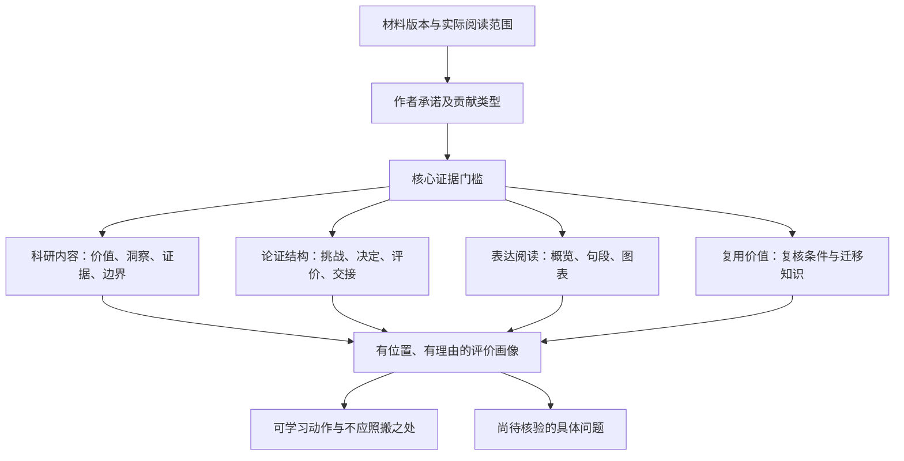

# 论文品鉴：从阅读印象到可迁移判断

## 这份综合的范围

本模块面向移动计算、无线网络、感知及相邻系统研究。调研材料包括公开写作讲座、研究者博客、课程中的论文批评要求、推荐阅读及经典系统写作/阅读文章，并阅读了六篇代表论文中的问题定义、设计、评价和边界相关部分，抽查关键原图。它不是对六篇论文所有证明、引用和实验的独立复现。

按项目要求，公开文档不保留研究者姓名、机构、个人主页、论文标题、系统名、DOI、独特原句或一对一身份映射。来源与页码核验记录留在仓库外；公开例子是重新构造的合成材料，不是替换姓名后的原文。**因此，公开读者不能仅靠这份匿名文档复核样本选择；它提供可使用的方法，而不是可公开复现的文献综述。** 在实际学术稿件中使用原始思想仍须正常引用，不能以匿名品鉴为由省略归属。

### 四种依据不能混写

| 依据 | 可以支持什么 | 不可以据此声称什么 |
|---|---|---|
| 作者直接分享 | 在该材料中明确提出的阅读/写作建议 | 所有时代、体裁都必须照做 |
| 主页推荐阅读 | 推荐过该资源，及资源作者实际说过的话 | 推荐者写了该文章或认同每条意见 |
| 论文阅读观察 | 某个结构、比较或解释在文本中如何工作 | 某位合作者的个人意图与固定风格 |
| 本项目方法设计 | 可操作的评价锚点、门槛、报告格式和测试 | 已被实验证明能预测录用或作者水平 |

同名作者的网络文章不能未经核对归属。本轮并未找到每位所选研究者自己的论文写作博客；课程、推荐清单和论文观察分别使用，没有补造“个人写作哲学”。其中一个可访问样本是公开修订稿，不能把其措辞当成最终发表版本。

## 一、品鉴不等于什么

**摘要**回答“做了什么”；**审稿**常聚焦“主张是否成立、是否值得发表”；**品鉴**进一步回答“哪里值得学习、它如何让读者理解和相信、我能迁移什么”。三者有交集，但交付不同。

品鉴不等于赞美。强论文也可能有不公平比较、版本不一致、表达夸张或不能外推的结果。发现这些问题并不取消其局部洞察的价值。反过来，一篇写得朴素的文章，也可能有可靠而重要的知识贡献。

品鉴也不等于精致包装。把证据缺口改成更顺的句子，只会让不成立的推断更难察觉。评价必须分开：

这里的四层和 14 个维度是本项目的综合设计，不是对任何人的评分标准的复刻。规程见 [完整维度与锚点](../../.ai_context/references/paper_appreciation_rubric.md)。

## 二、从分享与论文中保留的认识

### 1. 贡献是知识增量，不是劳动清单

写作分享和系统研究文章反复把问题、差异与证据联系起来。品鉴应能说清：读完后，读者对什么问题知道得更多，或能够完成什么以前难以完成的研究。

**操作化**：先写一个不含“首次、创新、突破”的贡献解释，再区分新机制、系统能力、测量发现、理论结论、数据资源和实践经验。工程工作量可以证明实现难度，却不能单独证明知识新颖性；组合已有技术也可能产生有价值的新能力。

### 2. 新颖性必须有参照系

“以前没人做”可能是因为问题没有价值，也可能只是检索不充分。改变任务、预算或假设后取得更好数字，不等于在同样条件下击败前作。

**操作化**：比较“问题、假设、资源、能力、证据”，不要只比较结果列。无法核验最近前作时，评价贡献表述是否清楚，但把实质新颖性留为未知。历史论文的价值应放回其条件，不用今天的器件能力倒推当年的问题很容易。

### 3. 关键洞察让复杂设计有理由

论文样本中的有效解释并不都靠长理论：有的从架构拆分切入，有的从资源竞争切入，有的从整个链路的瓶颈切入。共同价值在于使后续选择可预测，而不只是为选择命名。

**操作化**：问“这条观察让作者放弃了什么直觉方案，又选择了什么”。一个小例子、边界条件或失败现象常比重复“非平凡挑战”更有解释力。不能因为例子直观就把它当作普遍证明。

### 4. 模型要有消费者，结果要有问题

理论与系统结合的样本把数学量映射到可执行更新，并解释预测与实现间的差距。平台和感知样本则通过部件测试、整体能力与应用案例承担不同的证明任务。

**操作化**：每个重要模型问“它输出什么，被谁用于什么决定”；每组实验问“它回答哪一个疑问”。模型可以用于理解、预测或证明，不必都输出硬件参数；实验也不应为凑齐一套模板而存在。

### 5. 讲清选择比只讲清组件更有价值

在部分系统论文中，尝试过但不够好的中间设计帮助解释最终方案。有效读法不是记住实现顺序，而是恢复哪些约束排除了哪些备选。

**操作化**：为关键选择写“备选、权衡、证据、保留条件”。不要把重构后的论证顺序冒充真实发现历史；不能虚构“我们最初尝试了……”来制造故事感。

### 6. 限制是知识的一部分，但披露不是豁免

阅读样本能看到明确的范围声明、模型残差解释和实现条件说明，也能看到较强的概览措辞与较窄证据之间的张力。值得学习的是让边界可见，而不是认为知名论文出现过的宽泛结论都安全。

**操作化**：限制要连到受影响主张。尚未测远距离不等于系统一定不能远距，也不等于远距已被证明；原型、仿真和预算推算可以互补，但不能互相冒名。

### 7. 清楚来自信息安排，不只是短句

写作讲座重视主旨、例子、段落和阅读顺序；阅读建议则允许从概览逐步进入细节。清楚不是删掉所有复杂内容，而是在读者需要之前提供足够背景，并把细节放到有用的位置。

**操作化**：同时画知识依赖和阅读顺序。术语重复、被动语态或长句可以承担准确表达的功能；应修复的是无谓回溯、缺失前提和不明确动作，而不是文体表面。

### 8. 读懂后要能重建，也要能反驳

课程批评要求与分层阅读建议都超出摘要：辨认技术难点、贡献、强弱点和改进；深入阅读时尝试重建推理，发现隐含条件。

**操作化**：暂时不看正文，解释主要论证，再回原文查漏。这个过程是思想上的重建，不能写成“已复现”。若一个关键替代解释还成立，应保留而不是为了完整故事删掉它。

### 9. 引用存在不代表引用支持

有关引用核查的博客提醒了来源真实性问题。对品鉴而言，还必须多问一步：原文是否真的支持该句，而且版本、条件和比较对象是否相同。

**操作化**：沿用仓库的 Identity / Support / Use 三层核查。搜索命中、标题相似和引用数量都不能代替读原文；评估资源透明度时也不把链接存在等同于可运行。

## 三、具体的品鉴读法

### 第一遍：建立可纠正的理解

读标题、摘要、引言、标题层级、核心图与结论，记录版本及范围。目标是回答“它承诺建立什么知识，为什么值得继续读”。不是立刻给全篇打分。

产物可以只有几行：问题、贡献类型、关键想法、证据形式、最重要的未知。把自己的误解保留为待验证假设，不急着归咎于作者写得差。若任务只是筛选文献，到这里即可停止。

### 第二遍：追踪论证的输入输出

围绕核心主张读方法与评价。已有系统论证工作表时沿用其中 C/H/D/E/B；否则使用简单的自然语言联系，不为了品鉴额外建一套同义表。

对每个重点段落标注作用：建立条件、提出问题、排除直觉方案、解释机制、给出证据、限制结论、连接后文。这不是要求一个段落只能有一种功能，而是检查读者能否看出它为何在这里。

记录关键交接：

| 交接 | 读者需要得到什么 | 常见断点 |
|---|---|---|
| 场景 -> 问题 | 可观察的需求或约束 | 行业热度突然跳到技术方案 |
| 问题 -> 挑战 | 现有方法在什么条件下失效 | 用“复杂、困难”代替原因 |
| 挑战 -> 洞察 | 哪个新观察改变了解法 | 洞察只是模块名称 |
| 洞察 -> 设计 | 机制、输入输出和必要选择 | 声称受启发但没有实现对应 |
| 设计 -> 评价 | 哪项主张需要哪种对照 | 漂亮总结果替代因果归因 |
| 评价 -> 结论 | 结果允许多大的推断范围 | 局部证据升级成普遍优势 |

### 第三遍：在关键处深读

选择会改变核心判断的细节，而不是平均用力读所有内容：假设是否合理、定义是否一致、样本独立单位、训练测试隔离、预算匹配、误差来源、是否在目标设备运行、是否确为端到端测量。

至少试一种反事实：若去掉核心组件、匹配资源预算、换一种合理基线或进入失败区域，主张还成立吗？这是一种检查方法，不表示作者必须做所有想象得到的实验。理论、测量和系统类论文分别选择适合的验证。

看图时核对原页。曲线位置、坐标尺度、误差条和多栏顺序不能完全依赖文字提取；看不清就写无法判断，不能从图注猜数值。

### 第四步：欣赏与迁移

前三遍是可按任务缩短的阅读深度，不是固定时长考试。读后，把值得学习的做法写成迁移卡：

> 原文位置 -> 作者做了什么 -> 为什么有用 -> 需要什么条件 -> 当前稿件怎样采用 -> 哪些地方不能照搬。

学习“先解释对照方案为何受限”不等于套用原作者句子；学习“把边界放在引言”不等于每篇都必须同一段落。没有当前稿件时，只提供条件性建议，不凭空生成其结果。

## 四、可选的篇章组织方式

这些是本项目综合出的分析视角，不是指定作者的风格分类，也没有优先级。按问题和证据选择，可以混合。

| 组织方式 | 阅读路线 | 适合什么材料 | 需要警惕 |
|---|---|---|---|
| 需求驱动 | 使用条件 -> 成功要求 -> 技术障碍 -> 设计 -> 验证 | 需求会实质改变系统设计 | 情境故事很动人，却没有需求证据 |
| 反常观察驱动 | 预期 -> 观察到偏差 -> 原因假说 -> 机制 -> 区分性验证 | 有可靠先导测量 | 单次异常被讲成普遍现象 |
| 设计选择驱动 | 候选方案 -> 关键约束 -> 取舍 -> 最终结构 | 架构和实现贡献 | 虚构失败历程，或故意弱化替代方案 |
| 洞察驱动 | 简单例子 -> 新观察 -> 推广 -> 实现 -> 边界 | 核心思想可直观展示 | 例子替代证明，隐去反例 |
| 理论到系统 | 定义与假设 -> 推导 -> 可执行决定 -> 预测与实现差异 | 模型真正参与设计 | 公式很多但没有消费者 |
| 能力使能 | 现有研究做不了什么 -> 开放接口 -> 校准验证 -> 新实验能力 | 平台、工具、数据资源 | 把功能清单当成科学贡献 |
| 测量与经验 | 研究问题 -> 抽样和测量 -> 规律 -> 解释 -> 可推广经验 | 部署、实证、失败研究 | 选择性样本、观察与因果混淆 |

Related Work 可以先建立比较维度，也可以在读者理解方案后详细展开。先导实验可以放在动机中，机制实验可以与设计交织。判断依据是信息依赖、核心承诺与篇幅预算，不是目录顺序是否像范文。

## 五、逐节品鉴的关注点

### 标题与摘要

标题是否能让目标读者识别对象和贡献，而不承诺超出证据的能力？摘要能否让只读一段的人理解问题、主要做法、结果类型和必要条件？不要把摘要变成“本文依次介绍……”的目录，也不要把所有器件名称挤进标题。

品鉴概览时，要回到正文检查指标定义与比较条件。例如正文是某配置下的估算，摘要不能省略条件后变成普遍实测。压缩篇幅可以改变措辞，不能改变证据类型。

### 引言与相关工作

引言的有效性体现在读者知道“为什么现有路径不够、这里的新想法是什么、全文要证明什么”。问题不是背景少才好，而是每段背景是否参与了后面的推理。

相关工作应解释差异而不制造稻草人：承认前作在哪些目标下有效，说明本文改变哪个约束或能力。表格中的勾选条件要可查，缺描述不等于前作不支持。

### 设计与分析

先看主干能否理解，再看细节是否精确。好的局部展开常有“本节问题、直观解释、机制/模型、实际决定、下一步接口”；但不必每节用同样句式。

对公式不问“是否足够高级”，而问变量、假设、输出和影响。对实现不问“工作量是否大”，而问哪一部分是让想法成立的关键、哪些只是已有组件、换件后结论会怎样。

### 实现与评价

实现要让读者知道到底做到了哪个层级。组件实测加上其他组件估算可以形成合理的预测，但不能合称整机实测。端到端代价还应遵守该论文自己声明的系统边界。

评价不只是展示赢家。先说明实验问题、比较设置、指标及样本，再解释结果；负结果、尾部和饱和点能帮助理解边界。跨论文数字适合做情境对照时就这样标明，不能假装公平 head-to-head 比较。

### 讨论、局限与结论

局限写得有价值，需要解释它影响的是机制成立、归因、外推还是部署可用性。分类必须由证据决定。原型局限有时确实是工程问题，但“工程问题”仍可能让当前核心应用承诺不成立。

结论回答最初的问题并提炼学到了什么。它可以有明确立场，不必自我贬低；也不应把正文已承认的限制消失掉。未来工作应区分有依据的优化方向、尚未验证的假设与未解决的核心问题。

## 六、句段、图表与阅读体验

### 看句段时，解释功能而不是数特征

有效段落通常让读者分清观察、解释和决定。例如“观测到噪声增加”不自动推出“新算法导致噪声增加”；缺少隔离变量时，应保留替代解释。多加一个 therefore 只会掩盖断点。

术语稳定可以减少记忆负担，不必同义替换；合理视角切换可以突出对象；被动句在过程或结果导向的段落中可以很好用。长句应按依赖关系和歧义判断，而不是按逗号数量判错。具体修复复用 [17 号句间推理模块](../../.ai_context/prompts/17_sentence_flow_agent.md)。

### 看图时，先问图承担什么工作

- 概念图：展示机制区别，不把概念箭头误当实测因果。
- 架构图：标清数据、控制或依赖关系；不是每个盒子都要宣称创新。
- 对照图：用一致编码让读者发现真正差异，保留比较口径。
- 分布图：让典型值、尾部和异常都可见，不用单个均值掩盖不稳定。
- 参数图：说明取舍、拐点与选型，而不只是“参数越大越好”。

颜色、留白和视觉节奏的价值是降低解码成本。即使图很漂亮，样本和误差含义不清也不能判证据充分；纯理论稿没有彩色架构图也不是缺陷。

## 七、怎样把评价变成可行动建议

**没有用的评价**：“结构优秀，故事性强，实验丰富，值得学习。”

**可行动的评价**：“在设计前给出对照方案的失效条件，使后面的两个模块不再像任意组合。此动作适用于已有失效证据的稿件；若目前只是猜测，先写成待验证假说，不能编造失败实验。”

完整报告提供阅读范围、论证路径、优点解释、维度画像、不可照搬之处、迁移卡及下一步。置信度与质量分列；不评估的维度不计零。核心证据门槛不能被图表和语言优势抵消，也不根据一个缺口否定全文所有价值。

多论文比较先对齐任务和已读范围，再解释“各自在哪些方面更有帮助”。通常比一个没有依据的综合排名更有用。规范和实例见 [品鉴模板](../../.ai_context/paper_appreciation_template.md)、[合成示例](../paper-appreciation-examples.md) 与 [行为测试](../../tests/paper_appreciation_cases.md)。

## 八、这套方法的限制

样本是有目的地选择的，不代表全部领域、全部写法或未录用论文；没有进行对照实验来证明某种结构导致录用。共著论文不能拆成某位教师的个人贡献。不同版本、访问失败和只读相关章节都会限制结论。

因此，这个模块提供的是**可解释的阅读和讨论工具**：让判断有依据，让好的做法可迁移，让未知仍然可见。它不保证论文质量、拒稿风险或录用结果，也不把研究工作不足当作纯写作问题。
